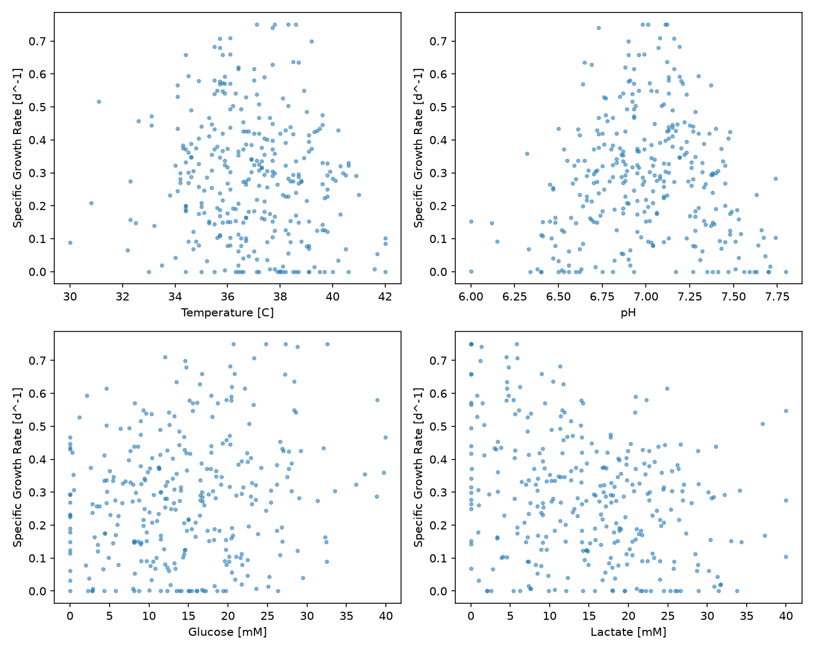
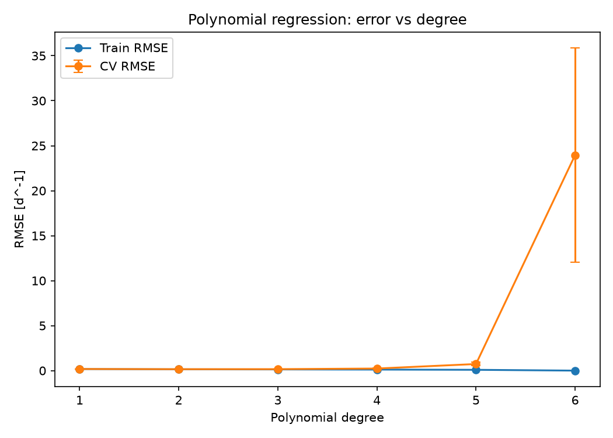
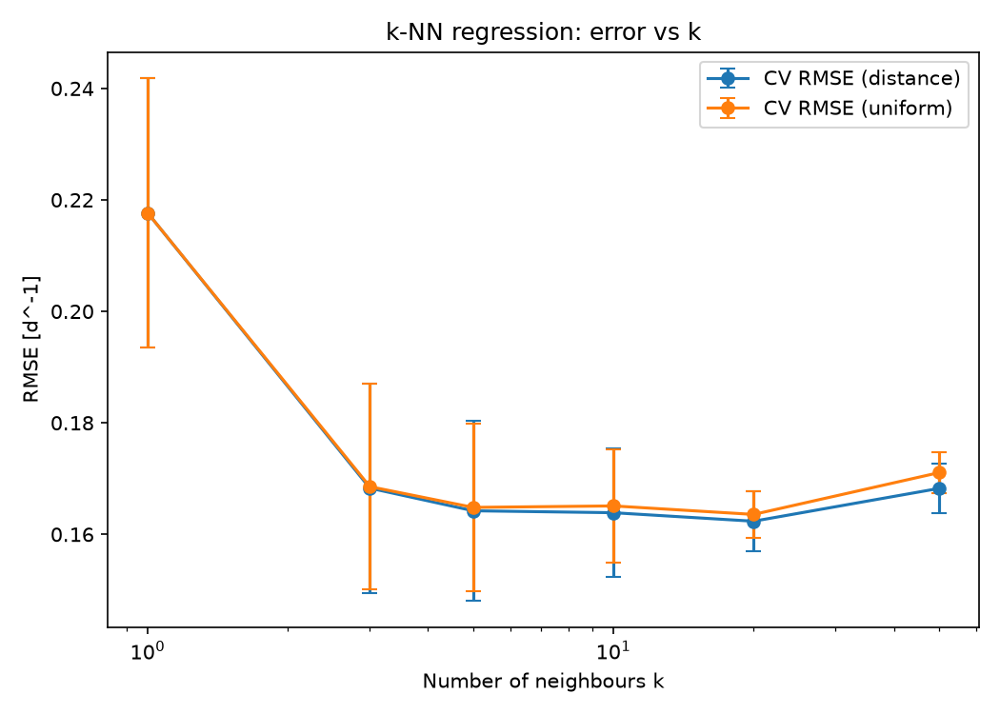
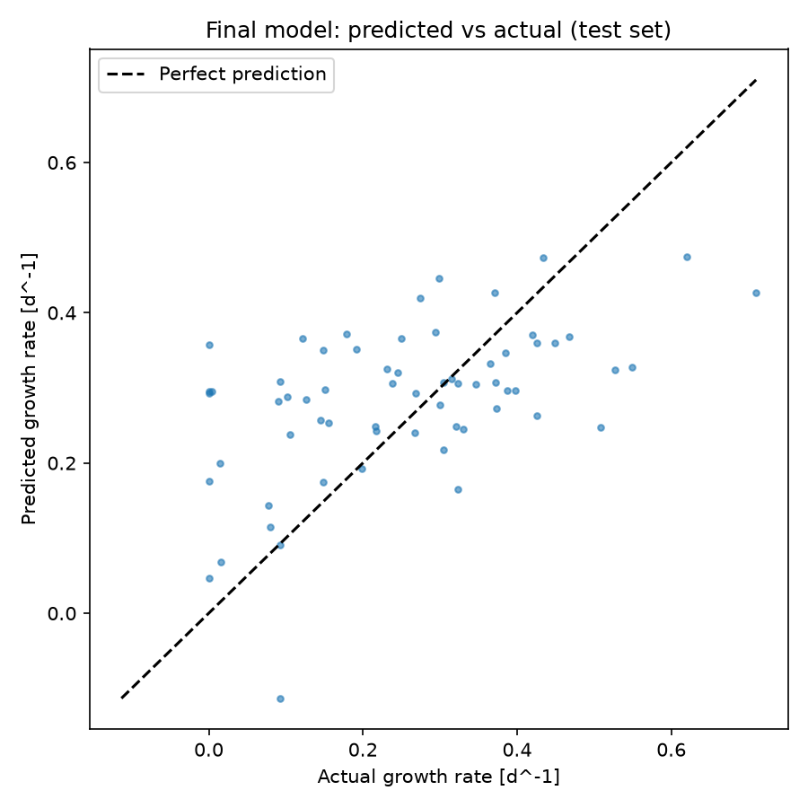
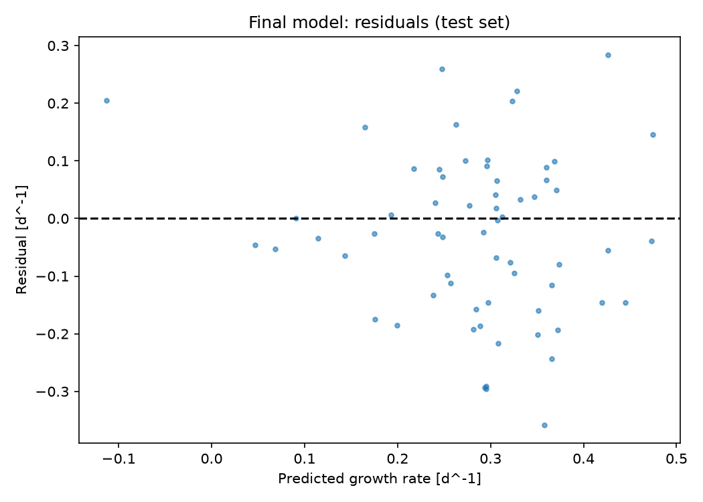
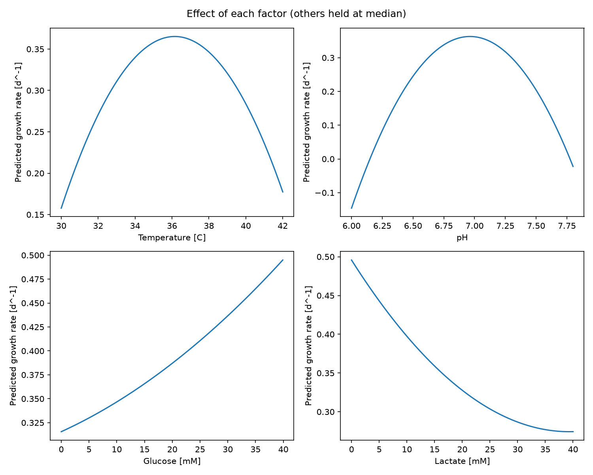

# Cell Growth Rate Predictor

This project builds and compares machine learning models that predict the specific growth rate of a cell culture from four process variables: temperature, pH, glucose concentration and lactate concentration. Because growth rate cannot be set directly in a bioreactor, a predictive model helps identify which operating conditions favour fast growth and which ones suppress it. The pipeline compares polynomial and k-nearest neighbours regression with cross-validation, selects the best model, and exports tables and figures as evidence.

## Highlights

- Built a modular, reproducible scikit-learn regression pipeline
- Compared 18 polynomial and k-NN models via cross-validation
- Prevented data leakage using scaling inside model pipelines
- Diagnosed overfitting from train versus validation error curves
- Visualized individual factor effects on predicted growth rate

## Environment

- Python 3.14.7
- matplotlib 3.11.0
- numpy 2.5.2
- pandas 3.0.5
- scikit-learn 1.9.0

## Code Design

Running `main.py` executes the full workflow from raw data to final figures. `main.py` itself stays short and reads like a recipe. Each stage is implemented in its own module inside `src/`, so every step can be understood, tested and modified independently.

### Data Loading

The first stage reads the dataset from `datasets/dataset_cell_growth_4factor.csv`, checks that the five expected columns are present, and removes any incomplete rows. It then separates the data into the four input variables (temperature, pH, glucose and lactate) and the target variable (specific growth rate).

This stage exists so that every later step can assume clean, correctly structured input. Checking column names up front means a renamed or corrupted file fails immediately with a clear message, instead of producing confusing errors deep inside model training. A summary table of the inputs (`tables/data_summary.csv`) and a scatter plot of growth rate against each variable (`figures/eda_scatter.png`) are exported at this point. They document the operating range covered by the data and give a first visual impression of the shape of each relationship, which later guides the choice of model.

### Train/Test Split

The data is divided into a training set (80%, 254 samples) and a held-out test set (20%, 64 samples) using a fixed random seed.

This separation is necessary because a model must be judged on data it has never seen. If the same data were used to both choose and evaluate a model, the reported error would be optimistic and would not reflect real performance on new cultures. The test set is locked away and used only once, at the very end, on the final selected model. The fixed seed makes every run identical, so results in this README can be reproduced exactly.

### Model Construction

This stage defines the candidate models. Two families are considered: polynomial regression with degrees 1 to 6, and k-nearest neighbours regression with k equal to 1, 3, 5, 10, 20 and 50, each with uniform and distance-based weighting. This gives 18 candidates in total.

Every candidate is built as a scikit-learn `Pipeline`. For polynomial models, the pipeline standardizes the inputs, expands them into polynomial and interaction terms, then fits ordinary least squares. For k-NN, the pipeline standardizes the inputs before the neighbour search. Standardization is essential for k-NN because it relies on distances: without it, variables with large numerical ranges such as glucose (0 to 40 mM) would dominate variables with small ranges such as pH (6.0 to 7.8). Wrapping preprocessing inside the pipeline also guarantees that scaling parameters are learned only from the training data in each fold, which prevents information from the validation data leaking into the model.

### Cross-Validation and Model Selection

Each of the 18 candidates is evaluated with 5-fold cross-validation on the training set. The training data is split into five parts; each model is trained on four and validated on the fifth, rotating until every part has been used for validation once. For every model, the mean training RMSE, mean validation RMSE, its standard deviation across folds, the validation MAE and the validation R² are recorded and exported to `tables/cv_results_all_models.csv`.

This stage is the core of the project because it makes the comparison between models fair and quantitative. Averaging across five folds gives a more stable estimate than a single split, and the standard deviation shows how sensitive each model is to the particular data it sees. Recording training error alongside validation error makes overfitting visible: a model that fits training data very well but validates poorly is memorizing noise. Two figures summarize this stage: `figures/polynomial_degree_curve.png` and `figures/knn_k_curve.png`. The candidate with the lowest mean validation RMSE is selected.

### Final Training and Testing

The selected model is retrained on the full training set and evaluated once on the held-out test set. The test RMSE, MAE and R² are exported to `tables/final_model_test_scores.csv`.

This step confirms that the performance measured during cross-validation carries over to genuinely unseen data. If the test error were much worse than the cross-validation error, it would indicate that the model selection process itself had overfit.

### Diagnostics and Interpretation

The final stage produces three figures from the selected model. A parity plot (`figures/final_parity.png`) compares predicted and actual growth rates on the test set. A residual plot (`figures/final_residuals.png`) checks for systematic patterns in the errors. Finally, a factor effect plot (`figures/factor_effects.png`) varies one input across its observed range while holding the other three at their median values, and records the predicted growth rate (`tables/factor_effects.csv`).

This stage turns the model from a black box into a tool for understanding the process. The factor effect curves show directly how each variable influences growth and where the optimum lies, which is what an engineer needs in order to make decisions about operating conditions.

## Analysis

### Dataset Characteristics

The dataset contains 318 simulated cultures covering temperatures of 30 to 42 °C, pH 6.0 to 7.8, glucose 0 to 39.9 mM and lactate 0 to 40 mM. Specific growth rate ranges from 0 to 0.75 d⁻¹ with a mean of 0.28 d⁻¹.

Two features of the data shape the whole analysis. First, the data is noisy: at any given temperature or pH, observed growth rates span almost the full range of the target. Second, the target is bounded, with 24 cultures showing zero growth and several reaching the 0.75 d⁻¹ ceiling. Together, these mean that a large share of the variance cannot be explained by the four inputs, so no model is expected to reach a high R². The goal is therefore to find the model that captures the real underlying trends without fitting the noise.

The scatter plots also reveal that temperature and pH have a curved, peaked relationship with growth, while glucose and lactate act more monotonically. The linear correlation between pH and growth rate is only 0.01, even though pH clearly matters visually. This is the signature of a non-linear effect that a straight line cannot represent, and it is the first argument against a purely linear model.

### Model Comparison

All 18 candidates were compared using 5-fold cross-validation on the training set.

| Model | Train RMSE | CV RMSE | CV RMSE Std | CV R² |
|:--|--:|--:|--:|--:|
| Polynomial (degree=2) | 0.1460 | 0.1592 | 0.0164 | 0.302 |
| kNN (k=20, distance) | 0.0000 | 0.1624 | 0.0053 | 0.283 |
| kNN (k=20, uniform) | 0.1545 | 0.1636 | 0.0041 | 0.272 |
| kNN (k=10, distance) | 0.0000 | 0.1639 | 0.0115 | 0.266 |
| kNN (k=5, distance) | 0.0000 | 0.1642 | 0.0162 | 0.257 |
| Polynomial (degree=3) | 0.1340 | 0.1648 | 0.0131 | 0.261 |
| kNN (k=5, uniform) | 0.1334 | 0.1648 | 0.0151 | 0.252 |
| kNN (k=10, uniform) | 0.1460 | 0.1651 | 0.0101 | 0.257 |
| kNN (k=50, distance) | 0.0000 | 0.1682 | 0.0045 | 0.229 |
| kNN (k=3, distance) | 0.0000 | 0.1683 | 0.0188 | 0.217 |
| kNN (k=3, uniform) | 0.1169 | 0.1686 | 0.0184 | 0.214 |
| kNN (k=50, uniform) | 0.1684 | 0.1711 | 0.0037 | 0.203 |
| Polynomial (degree=1) | 0.1764 | 0.1804 | 0.0053 | 0.113 |
| kNN (k=1, distance) | 0.0000 | 0.2177 | 0.0242 | -0.318 |
| kNN (k=1, uniform) | 0.0000 | 0.2177 | 0.0242 | -0.318 |
| Polynomial (degree=4) | 0.1164 | 0.2323 | 0.0374 | -0.503 |
| Polynomial (degree=5) | 0.0901 | 0.7331 | 0.1850 | -14.57 |
| Polynomial (degree=6) | 0.0000 | 23.958 | 11.908 | < -10000 |

#### Polynomial Regression

The polynomial results show a textbook bias–variance trade-off. A degree 1 model underfits: training and validation errors are both high and nearly equal, because a linear function cannot represent the optimum in temperature and pH. Moving to degree 2 reduces validation RMSE from 0.180 to 0.159 d⁻¹, the largest single improvement in the study, because squared terms allow the model to describe a peak.

Beyond degree 2, training error keeps falling while validation error rises. At degree 3 the gap begins to widen, and at degree 4 the validation R² becomes negative, meaning the model is worse than simply predicting the mean. At degree 6 the model has 209 polynomial terms but only about 203 training samples per fold, so it can pass exactly through every training point (training RMSE of zero) and produces extreme, meaningless predictions on validation data. Degree 2 is therefore the clear optimum within this family.

#### k-Nearest Neighbours Regression

The k-NN results follow the same logic with k controlling complexity in the opposite direction. With k = 1, each prediction copies a single neighbour, so the model reproduces the noise and validates poorly (CV R² of -0.32). Increasing k averages over more neighbours and smooths out noise, and the best result is reached at k = 20 with distance weighting (CV RMSE 0.162 d⁻¹). At k = 50 the model averages over so many cultures that it starts to blur real trends, and error rises again.

The training RMSE of zero for all distance-weighted models is not evidence of a good fit. When a training point is predicted, its distance to itself is zero, so it receives all of the weight. This is a known artifact, which is why validation error rather than training error is used for selection.

### Selected Model and Justification

The selected model is **second-order polynomial regression** on standardized inputs, including all squared and pairwise interaction terms (14 features plus an intercept). It was selected for four reasons.

First, it achieved the lowest cross-validated RMSE (0.159 d⁻¹) and highest CV R² (0.30) of all 18 candidates. Second, its structure matches the expected biology: a quadratic can represent an optimum temperature and pH, and the interaction terms let the effect of one variable depend on another. Third, it produces a smooth, continuous, explicit equation, which is easier to interpret and to use for optimization than k-NN, which only stores the training data. Fourth, it is compact, with 15 coefficients compared to the 254 stored samples required by k-NN.

The best k-NN model (k = 20, distance) lies within one standard deviation of the quadratic model, so the two are statistically close in accuracy. In that situation the more interpretable and smoother model is preferred. k-NN also has structural disadvantages for this problem: it cannot extrapolate beyond the data, it becomes less reliable as the number of input dimensions grows, and its predictions change in steps rather than smoothly as an input is varied.

### Test Set Performance

The selected model was retrained on all training data and evaluated once on the 64 held-out samples.

| Model | Test RMSE | Test MAE | Test R² |
|:--|--:|--:|--:|
| Polynomial (degree=2) | 0.1455 | 0.1173 | 0.221 |

The test RMSE of 0.146 d⁻¹ is consistent with the cross-validation estimate of 0.159 ± 0.016 d⁻¹, confirming the model generalizes as expected. The R² of 0.22 is modest, which reflects the high noise level of the data rather than a failure of model selection. The parity plot shows that the model captures the overall trend but compresses predictions toward the mean: it tends to overpredict very slow cultures and underpredict very fast ones.

### Advantages and Limitations

The main advantages of the model are its interpretability, smoothness and robustness. Its predictions vary continuously with every input, it captures the optimum in temperature and pH, and it showed stable performance across folds and on the test set.

Its limitations come from the shape of a quadratic. Polynomials are not bounded, so the model can predict physically impossible negative growth rates, for example around −0.15 d⁻¹ at pH 6.0 when other variables are at their median. A quadratic is also symmetric around its optimum, whereas real cells often decline faster above the optimum temperature than below it. For glucose, the model predicts a steadily increasing effect, while real cells typically show saturation (Monod-type kinetics) where additional glucose no longer helps. Finally, the model explains only about 20 to 30% of the variance, so individual predictions carry an uncertainty of roughly ±0.15 d⁻¹ and should be interpreted as trends rather than precise values.

### Influence of Each Process Variable

**Temperature** shows a clear optimum near 36 °C, consistent with typical mammalian cell culture. Predicted growth falls to about 0.16 d⁻¹ at 30 °C and 0.18 d⁻¹ at 42 °C. Low temperature slows enzymatic and metabolic rates, while high temperature causes heat stress and protein denaturation.

**pH** has the strongest effect of the four variables, with an optimum near pH 7.0. Predicted growth drops sharply on both sides, since deviations from neutral pH disrupt enzyme activity, membrane transport and intracellular homeostasis.

**Glucose** increases predicted growth from about 0.32 d⁻¹ at 0 mM to 0.50 d⁻¹ at 40 mM. Glucose is the primary carbon and energy source, so its availability supports faster growth.

**Lactate** decreases predicted growth from about 0.50 d⁻¹ at 0 mM to 0.27 d⁻¹ at 40 mM, with the effect flattening at high concentrations. Lactate is a byproduct of glycolytic metabolism and inhibits growth as it accumulates, partly through acidification of the medium and osmotic stress.

### High and Low Growth Conditions

High specific growth rates are predicted for cultures held near 36 °C and pH 7.0, with abundant glucose (above about 25 mM) and low lactate (below about 10 mM). This corresponds to a healthy early-phase culture.

Low specific growth rates are predicted when temperature or pH move far from their optimum (below 32 °C or above 40 °C, below pH 6.5 or above pH 7.5), when glucose is depleted, or when lactate has accumulated above about 25 mM. In practice, several of these tend to occur together late in a batch culture, when glucose is consumed, lactate builds up and pH drifts downward.

### Conditions Where Predictions Are Unreliable

The model should not be trusted outside the range of the training data (30 to 42 °C, pH 6.0 to 7.8, 0 to 40 mM glucose and lactate), because polynomial predictions diverge rapidly once extrapolated. Even inside this range, data is sparse at the edges: only 13 cultures were run below 33 °C or above 41 °C, 21 below pH 6.4 or above pH 7.6, 13 above 30 mM glucose and 21 above 30 mM lactate. Predictions in these regions, and especially for combinations of several extreme values, rely on very few observations. Predictions close to zero are also unreliable, since the model may return negative values that have no physical meaning.

### Potential Applications

The model can support early process development by identifying promising operating windows before running costly bioreactor experiments, and by narrowing the ranges explored in a design of experiments. It can guide control strategy, for example by indicating the lactate concentration at which growth begins to decline sharply, which could trigger a medium exchange or a change in feeding strategy in fed-batch culture. Combined with online measurements of temperature, pH, glucose and lactate, it could also act as a simple soft sensor that estimates growth rate in real time. Given its moderate accuracy, it is best used to rank conditions and identify trends, with final decisions confirmed experimentally. Future improvements could include additional variables such as dissolved oxygen, glutamine and ammonia, and mechanistic model forms that respect physical bounds and saturation behaviour.